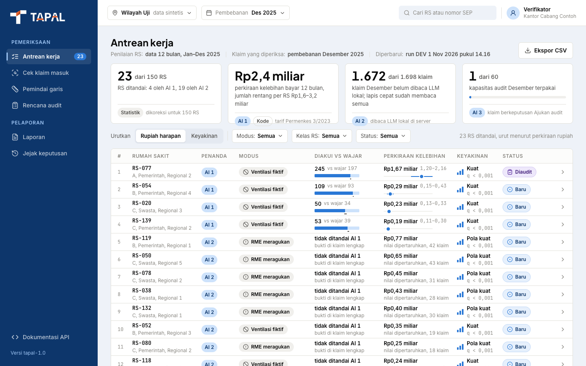
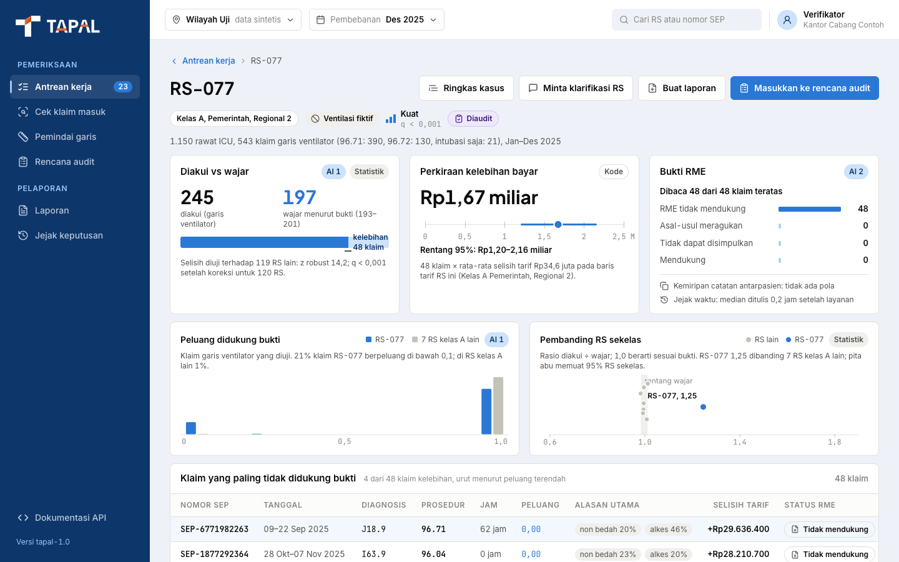
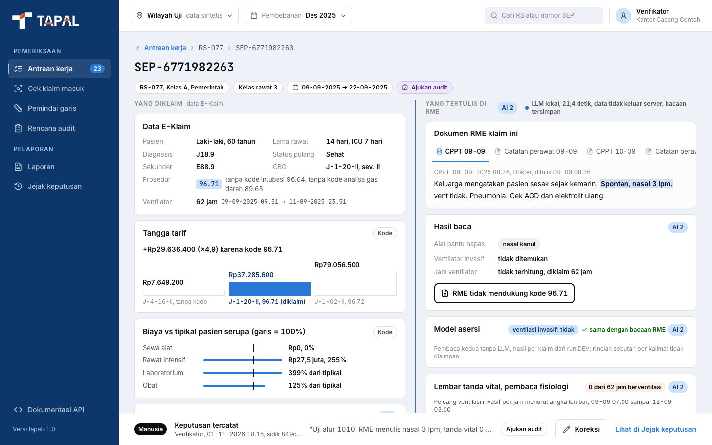
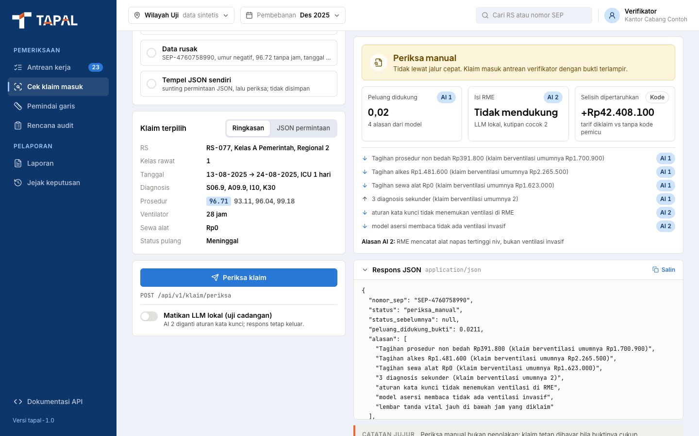
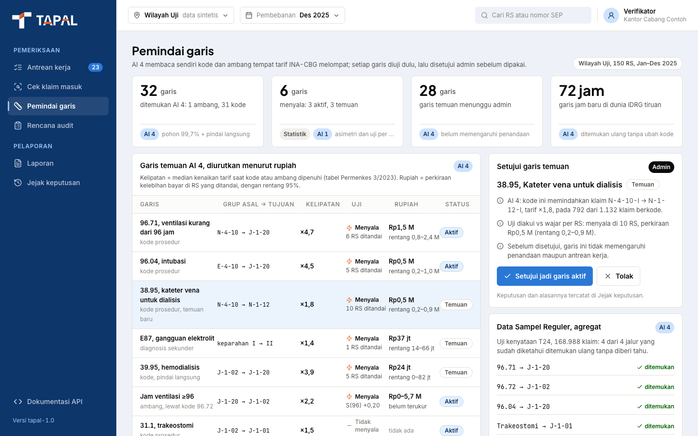
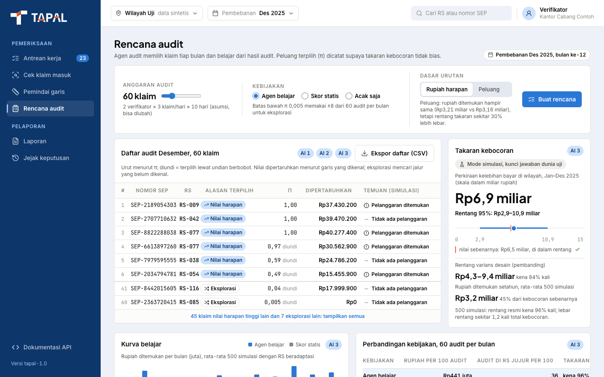
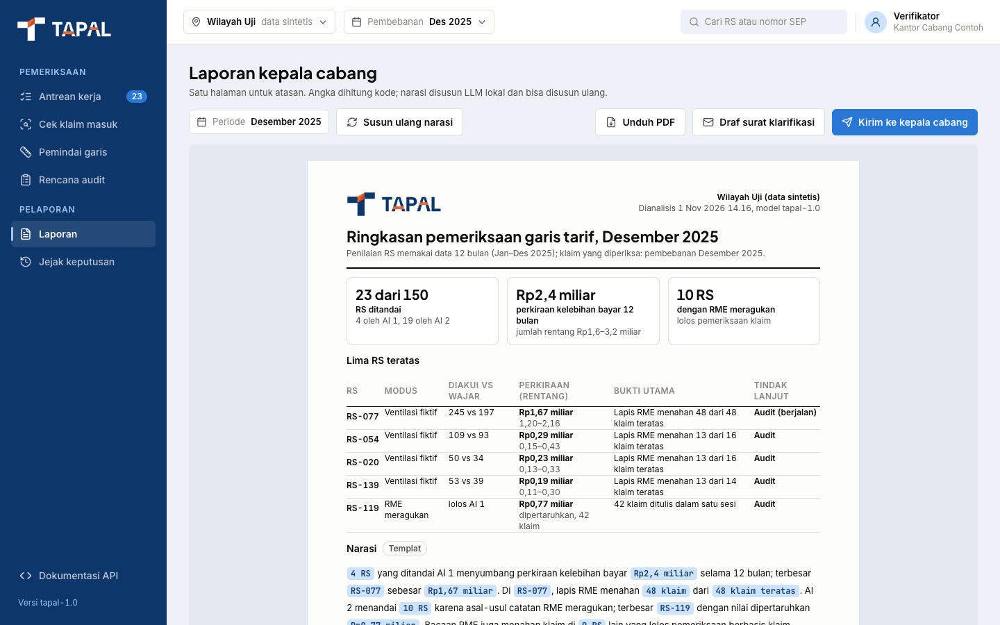
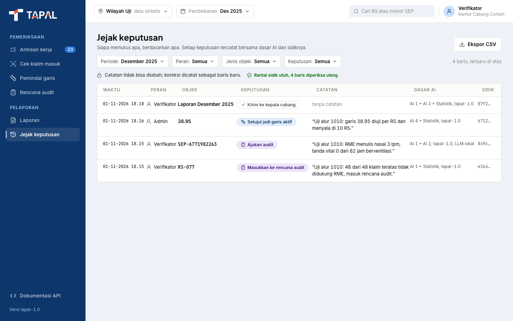
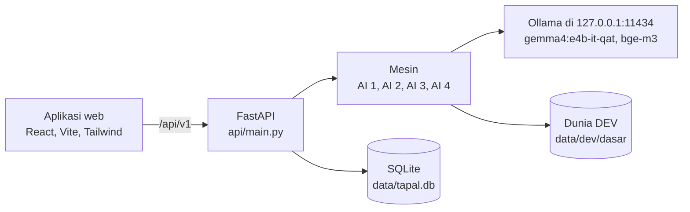

<p align="center">
  <picture>
    <source media="(prefers-color-scheme: dark)" srcset="docs/assets/tapal-logo-white.svg">
    
  </picture>
</p>

<h3 align="center">Tariff Anomaly Probe Across Lines</h3>

<p align="center"><i>"Kodenya sah. Buktinya ada?"</i></p>

<p align="center"><a href="README.md">English</a> | <b>Bahasa Indonesia</b></p>

<p align="center">
  
  
  
  
  
  
  
</p>

## Daftar isi

- [Tentang TAPAL](#tentang-tapal)
- [Tangkapan layar](#tangkapan-layar)
- [Cara kerja](#cara-kerja)
- [Prasyarat](#prasyarat)
- [Pemasangan](#pemasangan)
- [Menyiapkan data](#menyiapkan-data)
- [Menjalankan aplikasi](#menjalankan-aplikasi)
- [Menjalankan pipa DEV](#menjalankan-pipa-dev)
- [Menjalankan tes](#menjalankan-tes)
- [Aturan uji buta](#aturan-uji-buta)
- [API](#api)
- [Struktur folder](#struktur-folder)
- [Pemecahan masalah](#pemecahan-masalah)
- [Data, privasi, dan atribusi](#data-privasi-dan-atribusi)
- [Berkontribusi](#berkontribusi)
- [Lisensi](#lisensi)

## Tentang TAPAL

TAPAL adalah prototipe untuk BPJS Kesehatan Healthkathon 2026, kategori Faskes. TAPAL memeriksa klaim rawat inap bukan bayi yang berada di garis tarif ventilator INA-CBG: kode prosedur 96.71 dan 96.72, intubasi 96.04, dan garis 96 jam. TAPAL menandai klaim yang kode atau jam ventilatornya tidak didukung bukti lain di klaim maupun di rekam medis elektronik (RME), lalu mengubahnya menjadi daftar kerja verifikator, perkiraan kelebihan bayar per RS, dan sampel audit bulanan. AI menebak, statistik menguji, dan verifikator yang memutus; semua data di repo ini sintetis.

| Mesin | Tugas | Metode |
|---|---|---|
| AI 1 | Menebak peluang klaim memang berventilasi (dan mencapai 96 jam) hanya dari bukti lain di klaim, lalu membandingkan jumlah klaim yang diakui setiap RS dengan jumlah yang wajar menurut bukti | HistGradientBoosting terkalibrasi, *cross-fitting* dengan lipatan per RS |
| AI 2 | Membaca RME. LLM hanya menyalin kutipan; kode mencocokkan setiap kutipan kata per kata dan menghitung jam ventilasi. Model asersi klinis, pembaca fisiologi, kemiripan catatan, dan jejak waktu penulisan menambah pemeriksaan yang independen | `gemma4:e4b-it-qat` lewat Ollama (suhu 0, seed 42, keluaran dipaksa skema JSON), embedding `bge-m3` |
| AI 3 | Agen audit yang belajar: memilih klaim yang diaudit setiap bulan (eksploitasi dan eksplorasi), mencatat peluang terpilih setiap klaim, dan menjaga takaran kebocoran tetap tak bias | Model hasil audit berbobot kebalikan peluang terpilih, dengan setiap π ≥ `PI_MIN` |
| AI 4 | Penemu garis tarif: menemukan sendiri kode pemicu dan ambang tempat tarif melompat, lalu menguji setiap garis sebelum menyala | Model pengganti fungsi tarif |
| Statistik | Menguji setiap RS terhadap RS lain dan memeriksa penumpukan di garis 96 jam | Observasi vs harapan, koreksi BH-FDR, uji asimetri dengan garis plasebo |

## Tangkapan layar

<table>
  <tr>
    <td width="50%"><br><b>Antrean kerja</b>: RS yang ditandai, diurutkan menurut perkiraan kelebihan bayar atau keyakinan</td>
    <td width="50%"><br><b>Profil RS</b>: klaim diakui dibanding klaim wajar, RS pembanding, klaim teratas, dan bukti RME</td>
  </tr>
  <tr>
    <td><br><b>Pemeriksaan klaim</b>: tangga tarif, alasan AI 1, kutipan RME terverifikasi, dan keputusan verifikator</td>
    <td><br><b>Cek klaim masuk</b>: pemeriksaan satu klaim secara langsung, dengan sakelar LLM dan penyunting JSON</td>
  </tr>
  <tr>
    <td><br><b>Pemindai garis</b>: garis tarif temuan AI 4 beserta ujinya</td>
    <td><br><b>Rencana audit</b>: daftar audit bulanan dari AI 3 dan takaran kebocoran</td>
  </tr>
  <tr>
    <td><br><b>Laporan</b>: laporan satu halaman untuk kepala cabang, unduhan PDF, dan draf surat klarifikasi</td>
    <td><br><b>Jejak keputusan</b>: log keputusan tambah-saja dengan sidik berantai dan ekspor CSV</td>
  </tr>
</table>

Antarmuka aplikasi berbahasa Indonesia. Semua RS dan klaim di layar adalah data sintetis.

## Cara kerja



- **Respons dua tahap.** `POST /api/v1/klaim/periksa` langsung mengembalikan hasil AI 1 dan lapis cepat AI 2. Sesudah itu satu pekerja di dalam proses API membaca RME dengan LLM lokal, dan status akhirnya menyusul lewat `GET /api/v1/klaim/{nomor_sep}/rme`.
- **Aturan cadangan.** Bila LLM dimatikan atau tidak menjawab dalam 120 detik, aturan kata kunci yang membaca RME, dan respons tetap keluar.
- **Status klaim.** `lolos_cepat`, `periksa_manual`, dan `didukung_rme` (bukti di klaim kurang, tetapi RME mendukung).
- **Jejak keputusan.** Setiap keputusan verifikator ditambahkan ke tabel SQLite yang menolak UPDATE dan DELETE lewat trigger. Setiap baris membawa sidik SHA-256 berantai yang diverifikasi API saat mulai.
- **Satu alamat.** FastAPI menyajikan hasil build aplikasi web dari `web/dist`, sehingga aplikasi dan API memakai satu port.

## Prasyarat

| Kebutuhan | Versi | Catatan |
|---|---|---|
| Sistem operasi | macOS atau Linux | Mesin acuan: Apple M1 dengan RAM 16 GB. Pipa DEV satu perintah untuk sementara hanya berjalan di macOS (lihat [Pemecahan masalah](#pemecahan-masalah)). |
| Python | 3.12 | Diuji pada 3.12.2. Kode memakai mode autocommit `sqlite3`, yang baru ada di Python 3.12. |
| Node.js | 24 | Diuji pada 24.21.0 dengan npm 11.19.0. Vite 8 butuh Node 20.19+ atau 22.12+. |
| Ollama | 0.40.13 | Server LLM lokal di `127.0.0.1:11434`. |
| Google Chrome | versi terbaru | Opsional, hanya untuk laporan PDF. |

Unduh dua model lokal:

```bash
ollama pull gemma4:e4b-it-qat   # pembaca RME dan narasi, sekitar 6,2 GB
ollama pull bge-m3              # embedding kalimat untuk AI 2, sekitar 1,2 GB
```

**Memori dan disk.** RAM 16 GB disarankan karena LLM, model embedding, dan API berjalan di satu mesin. Siapkan ruang disk kosong sekitar 10 GB untuk model, data, dan `node_modules`. Di mesin dengan memori lebih kecil, jalankan aplikasi dengan `TAPAL_LLM=off`.

## Pemasangan

Klon ke folder induk tersendiri, karena laporan pipa dan data ICU terbuka disimpan di folder sebelah repo (`../tapal-percobaan` dan `../tapal-data-terbuka`):

```bash
mkdir tapal && cd tapal
git clone https://github.com/iqbal-rahmatullah/tapal-ai.git tapal-v2
cd tapal-v2
```

Paket Python, di dalam lingkungan virtual:

```bash
python3.12 -m venv .venv
source .venv/bin/activate
python3 -m pip install -r requirements.txt
```

<details>
<summary>Paket Python dan kegunaannya</summary>

| Paket | Versi | Kegunaan |
|---|---|---|
| fastapi | 0.139.2 | API (`api/`) |
| uvicorn | 0.51.0 | server ASGI |
| pydantic | 2.12.5 | kontrak API dan skema keluaran LLM |
| httpx | 0.28.1 | klien Ollama dan klien uji FastAPI |
| numpy | 2.1.3 | komputasi numerik |
| pandas | 3.0.2 | tabel klaim |
| pyarrow | 24.0.0 | berkas Parquet |
| scipy | 1.17.1 | statistik, AI 4, generator dunia |
| scikit-learn | 1.8.0 | model AI 1 sampai AI 4 |
| joblib | 1.5.3 | berkas model dan cache DEV AI 1 |
| matplotlib | 3.11.1 | grafik laporan DEV |
| pytest | 8.4.2 | tes |

</details>

Paket web, terkunci di `web/package-lock.json`:

```bash
cd web
npm ci
cd ..
```

## Menyiapkan data

Repo ini hanya berisi kode. Folder `data/` diabaikan git, jadi setiap mesin membangun masukannya sendiri. Langkah 1 sampai 4 sudah cukup untuk menjalankan aplikasi dengan AI 1 dan pembaca LLM. Langkah 5 menambah lapis cepat AI 2 dan wajib untuk pipa DEV.

| Masukan | Letak | Cara mendapatkan |
|---|---|---|
| Kalibrasi ICU terbuka | `data/calibration/icu_open.json`, `data/icu_open/*.parquet` | langkah 1 |
| Kalibrasi Data Sampel (hanya agregat) | `data/calibration/data_sampel.json` | langkah 2 |
| Dunia DEV | `data/dev/dasar/`, `data/dev/idrg_tiruan/` | langkah 3 |
| Model AI 1 | `models/ai1-tapal-1.0.joblib` | langkah 4 |
| Model AI 2 | `models/ai2-fisiologi-tapal-1.0.joblib`, `models/ai2-asersi-tapal-1.0.joblib` | dilatih API saat pertama kali mulai (langkah 5) |
| Embedding kalimat DEV | `../tapal-percobaan/ai2-dev/embedding_kalimat_*` | dari tim TAPAL (langkah 5) |

### 1. Data ICU terbuka (eICU-CRD Demo dan MIMIC-IV Demo)

Kedua demo ini terbuka di PhysioNet dengan lisensi Open Database License (ODbL) v1.0 dan tidak ikut repo. Unduh sendiri ke `../tapal-data-terbuka/` dengan nama folder seperti di bawah, lalu ringkas:

```bash
mkdir -p ../tapal-data-terbuka/eicu-crd-demo-2.0.1 ../tapal-data-terbuka/mimic-iv-demo-2.2
curl -L -o ../tapal-data-terbuka/eicu-crd-demo-2.0.1/download.zip https://physionet.org/content/eicu-crd-demo/get-zip/2.0.1/
curl -L -o ../tapal-data-terbuka/mimic-iv-demo-2.2/download.zip https://physionet.org/content/mimic-iv-demo/get-zip/2.2/
unzip -q ../tapal-data-terbuka/eicu-crd-demo-2.0.1/download.zip -d ../tapal-data-terbuka/eicu-crd-demo-2.0.1
unzip -q ../tapal-data-terbuka/mimic-iv-demo-2.2/download.zip -d ../tapal-data-terbuka/mimic-iv-demo-2.2
python3 -m engine.synth.icu_open
```

Perintah terakhir membaca `eicu-crd-demo-2.0.1/eicu-collaborative-research-database-demo-2.0.1/` dan `mimic-iv-demo-2.2/mimic-iv-clinical-database-demo-2.2/`, lalu menulis `data/calibration/icu_open.json` dan `data/icu_open/*.parquet`. Setiap folder hasil ekstrak memuat `SHA256SUMS.txt`; periksa di dalam folder itu dengan `shasum -a 256 -c SHA256SUMS.txt` di macOS atau `sha256sum -c SHA256SUMS.txt` di Linux. Halaman dataset: [eICU-CRD Demo 2.0.1](https://physionet.org/content/eicu-crd-demo/2.0.1/) dan [MIMIC-IV Clinical Database Demo 2.2](https://physionet.org/content/mimic-iv-demo/2.2/).

### 2. Kalibrasi Data Sampel

Dunia sintetis dikalibrasi dari agregat Data Sampel BPJS 2025, yang tidak dapat dibagikan lewat repo ini. Bila Anda punya akses, arahkan skrip ke folder berisi berkas `.dta`:

```bash
python3 -m engine.synth.calibration --data "/path/to/Data Sampel Reguler Edisi 2025/data"
```

Tanpa `--data`, skrip membaca `~/Downloads/2025/Data Sampel Reguler Edisi 2025/data`. Keluarannya hanya angka agregat di `data/calibration/data_sampel.json`. Simpan berkas `.dta` di luar repo: `.gitignore` mengecualikannya, dan sebuah tes gagal bila ada berkas `.dta` di dalam repo. Tanpa akses, minta `data_sampel.json` kepada tim TAPAL.

### 3. Dunia DEV

```bash
python3 -m engine.synth.build dev
python3 -m engine.synth.build dev --condition idrg_tiruan
python3 -m engine.synth.checks data/dev/dasar
```

- Perintah pertama membangun dunia dasar `data/dev/dasar/`: 150 RS sintetis, klaim Januari sampai Desember 2025, dokumen RME dan lembar tanda vital, serta kunci jawaban terbuka di `data/dev/dasar/key/`.
- Perintah kedua membangun dunia iDRG tiruan (klaim saja) yang dipakai AI 4 di pipa DEV.
- Perintah ketiga adalah cek kewajaran opsional yang menulis `checks.json` dan `reality_table.csv` ke folder dunia.
- Seed-nya tetap (`SEED_DEV` = 20261031), jadi berkas kalibrasi dan versi paket yang sama menghasilkan dunia yang sama. Membangun ulang mengganti seluruh folder kondisi itu.

### 4. Model AI 1

```bash
python3 -m engine.ai1_dev
```

Perintah ini melatih AI 1 pada dunia DEV, menulis `models/ai1-tapal-1.0.joblib` beserta sidik SHA-256-nya di `models/ai1-tapal-1.0.json`, dan menulis laporan DEV ke `../tapal-percobaan/ai1-dev/`. API menolak berkas model yang tidak cocok dengan sidiknya.

### 5. Artefak AI 2

API memuat AI 2 di thread latar saat mulai. Bila `models/ai2-fisiologi-tapal-1.0.joblib` belum ada, API melatih pembaca fisiologi dari `data/icu_open/`. Bila `models/ai2-asersi-tapal-1.0.joblib` belum ada, API melatih lima pembaca asersi per lipatan RS pada dunia DEV. Keduanya disimpan ke `models/` untuk dipakai saat mulai berikutnya.

Pembaca asersi membutuhkan cache embedding kalimat DEV berikut di `../tapal-percobaan/ai2-dev/`:

```text
embedding_kalimat_bge_m3.npy
embedding_kalimat_teks.parquet
embedding_kalimat_lain_bge_m3.npy
embedding_kalimat_lain_teks.parquet
```

API membaca cache ini sebelum memuat atau melatih kedua model AI 2. Belum ada perintah di repo ini yang membangun keempat berkas itu (total sekitar 270 MB), jadi mintalah kepada tim TAPAL. Tanpa berkas itu aplikasi tetap berjalan: AI 1 menjawab dan LLM tetap membaca RME, tetapi respons melaporkan bahwa lapis cepat AI 2 gagal dimuat (`lapis AI 2 gagal dimuat`).

## Menjalankan aplikasi

Dari akar repo:

```bash
cd web && npm run build && cd ..
python3 -m uvicorn api.main:app
```

Lalu buka:

- Aplikasi: <http://127.0.0.1:8000>
- Dokumentasi API (Swagger UI): <http://127.0.0.1:8000/docs>

Catatan:

- `npm run build` menjalankan cek tipe TypeScript dan menulis `web/dist`. API hanya menyajikan `web/dist` bila folder itu sudah ada saat API mulai, jadi build dulu.
- Jalankan uvicorn sebagai satu proses, tanpa `--workers`: antrean pembacaan RME hidup di proses itu.
- Saat pertama kali mulai, AI 2 dimuat di latar (dan modelnya dilatih bila belum ada), jadi pemeriksaan klaim pertama bisa melaporkan bahwa lapis cepat masih dimuat.
- Sebelum demo, muat LLM ke memori lebih dulu supaya bacaan pertama tidak menunggu:

  ```bash
  curl http://127.0.0.1:11434/api/generate -d '{"model": "gemma4:e4b-it-qat", "keep_alive": "2h"}'
  ```

### Sakelar LLM

- Mulai tanpa LLM: `TAPAL_LLM=off python3 -m uvicorn api.main:app`. Aturan kata kunci yang membaca RME, dan ringkasan diisi dari templat.
- Saat aplikasi berjalan, sakelar di layar Cek klaim masuk (`PUT /api/v1/llm` dengan `{"aktif": false}`) mensimulasikan LLM mati untuk semua layar sampai API dimulai ulang. Sakelar ini tidak menghentikan Ollama. `GET /api/v1/llm` menampilkan `aktif`, `sakelar`, `tersedia`, dan `model`.

### Mode pengembangan

```bash
python3 -m uvicorn api.main:app   # terminal 1, API di port 8000
cd web && npm run dev             # terminal 2, aplikasi di http://localhost:5173
```

Vite meneruskan `/api`, `/docs`, dan `/openapi.json` ke `127.0.0.1:8000`.

### Variabel lingkungan (API)

| Variabel | Bawaan | Fungsi |
|---|---|---|
| `TAPAL_LLM` | `on` | `off` mematikan LLM lokal; aturan kata kunci dan templat yang menjawab |
| `TAPAL_DB` | `data/tapal.db` | berkas SQLite untuk jejak keputusan dan antrean RME |
| `TAPAL_CHROME` | `/Applications/Google Chrome.app/Contents/MacOS/Google Chrome` | biner Chrome untuk `GET /api/v1/laporan.pdf` |
| `TAPAL_WEB_URL` | alamat permintaan | alamat dasar yang dibuka Chrome untuk mencetak laporan |

Alamat Ollama tetap `http://127.0.0.1:11434`, ditulis di `engine/ai2.py`.

## Menjalankan pipa DEV

Satu perintah menjalankan semua mesin pada dunia DEV:

```bash
python3 -m engine.run_all
```

- Tahapnya tercantum di `STAGES` dalam `engine/run_all.py`: AI 1, uji garis, AI 4, lapis AI 2 dan pembacaan LLM, serta simulasi AI 3. Paling banyak empat tahap CPU berjalan bersamaan; tahap embedding dan LLM berjalan satu per satu sehingga tidak pernah berbagi GPU. Slot CPU dikurangi saat memori bebas menipis.
- Tahap yang selesai dengan kode keluar 0 meninggalkan titik simpan di `../tapal-percobaan/run-all/<tahap>.json` dan dilewati pada run berikutnya; hapus berkas `.json`-nya untuk mengulang. Log ada di `<tahap>.log` dan `kejadian.log` di folder yang sama.
- Untuk menjalankan sebagian tahap, sebut namanya, misalnya `python3 -m engine.run_all ai1 garis ai4`. Tahap yang dependensinya tidak disebut dan belum selesai akan tertahan.
- Perintah ini mencetak ringkasan JSON (`selesai`, `gagal`, `tertahan`) dan keluar dengan kode 1 bila ada tahap yang gagal.
- Laporan ditulis ke `../tapal-percobaan/<nama>/`, misalnya `ai1-dev`, `ai2-dev`, `ai3-dev`, `ai4-dev`, dan `garis-dev`.
- Pipa ini membutuhkan langkah 1 sampai 5 di atas, Ollama yang berjalan dengan kedua model, dan macOS.
- Tahap pembacaan LLM (`ai2_baca`) hanya menerima build model yang dibekukan: `ollama list` harus menampilkan ID `ee6656371218` untuk `gemma4:e4b-it-qat`. Run dari nol membaca sampel berlapis dengan kecepatan sekitar 48 detik per RME di M1, jadi butuh berjam-jam; run yang terhenti dilanjutkan dari bacaan yang sudah tersimpan.
- Tahap evaluasi tambahan `hkeval` hanya berjalan bila `../tapal-percobaan/hkeval/jalankan.py` ada.

### Variabel lingkungan (mesin)

| Variabel | Bawaan | Fungsi |
|---|---|---|
| `TAPAL_DUNIA` | `data/dev/dasar` | folder dunia yang dinilai |
| `TAPAL_KUNCI` | `$TAPAL_DUNIA/key` | folder kunci jawaban |
| `TAPAL_KELUARAN` | `../tapal-percobaan` | akar folder keluaran; bila disetel, run DEV menulis model di samping hasilnya, bukan ke `models/` |
| `TAPAL_BUKA_SEGEL` | tidak disetel | gerbang uji buta, lihat [Aturan uji buta](#aturan-uji-buta) |
| `TAPAL_LLM` | `on` | `off` mematikan LLM |
| `TAPAL_LLM_PARALEL` | `1` | jumlah permintaan LLM paralel di tahap pembacaan |
| `OMP_NUM_THREADS` | `2` | jumlah thread per tahap CPU, disetel `run_all` bila kosong |

Run DEV percobaan yang tidak menyentuh `models/`:

```bash
TAPAL_KELUARAN=../tapal-percobaan/run-dev python3 -m engine.run_all
```

## Menjalankan tes

```bash
cd web && npm run build && cd ..
python3 -m pytest -q
```

- `tests/test_smoke.py` memeriksa bahwa FastAPI menyajikan `web/dist`, jadi build aplikasi web dulu.
- Tes yang membutuhkan berkas kalibrasi atau dunia DEV dilewati bila berkas itu belum ada. Tes API juga membutuhkan model AI 1 dari langkah 4.
- Tes API memakai berkas SQLite sementara dan mematikan LLM, sehingga aturan cadangan kata kunci yang menjawab.
- `tests/test_blind_rules.py` menjaga uji buta: AI 2 tidak memuat kosakata gaya tulisan yang disisihkan, hanya generator dan `engine/data.py` yang menyebut folder uji buta, dan AI 4 tidak memuat nilai garis ventilator yang sudah diketahui.

## Aturan uji buta

- Aturan, target, dan konstanta beku ada di `TARGETS.md`. Hash `TARGETS.md`, hash manifes kunci TEST, dan hash pembekuan mesin (`freeze_manifest.json`) dicatat di `TARGETS.lock`, yang bersifat tambah-saja dengan satu commit per baris. Hash tidak pernah ditulis di dalam `TARGETS.md`.
- DEV (`data/dev/`) memakai seed tetap, dan kuncinya boleh dibuka. TEST dibangkitkan sekali dengan seed acak dan hanya dipakai sekali: berkas publiknya di `data/test/`, kuncinya disegel di `data/sealed/`. Kedua folder itu tidak ikut repo.
- `engine/data.py` adalah satu-satunya gerbang. Setiap jalur di dalam `data/test` atau `data/sealed` memunculkan `BlindTestError` kecuali `TAPAL_BUKA_SEGEL=720` disetel. Variabel itu hanya disetel di tugas 720, setelah hash pembekuan mesin tercatat di `TARGETS.lock`, semua hash cocok, dan pemilik proyek memberi aba-aba.
- Setelah segel dibuka, kode, konfigurasi, dan ambang tidak diubah. Yang boleh hanya perbaikan crash yang menghentikan proses, dan setiap perbaikan dicatat lengkap.
- `python3 -m engine.synth.build test` menolak menimpa set TEST yang sudah tersegel. Opsi `--replace-test` hanya untuk masa sebelum hash kunci dicatat.
- Satu gaya tulisan RME disisihkan dan hanya muncul di TEST. AI 2 tidak boleh memuat kosakata atau aturan khusus gaya itu.

## API

Semua endpoint berada di bawah `/api/v1`. Nama field JSON memang berbahasa Indonesia sesuai desain, misalnya `nomor_sep`, `peluang_didukung_bukti`, dan `selisih_tarif_dipertaruhkan`. Body POST wajib dikirim dengan `Content-Type: application/json`. Dokumentasi interaktif di `/docs` sudah memuat contoh klaim yang siap dicoba.

| Metode | Jalur | Layar | Fungsi |
|---|---|---|---|
| POST | `/klaim/periksa` | Cek klaim masuk | memeriksa satu klaim: AI 1 dan lapis cepat AI 2 langsung, pembacaan RME masuk antrean |
| GET | `/klaim/{nomor_sep}/rme` | Cek klaim masuk, Pemeriksaan klaim | status dan hasil pembacaan RME |
| GET | `/klaim/contoh` | Cek klaim masuk | contoh klaim dari dunia DEV |
| GET | `/klaim/{nomor_sep}` | Pemeriksaan klaim | rincian klaim dan keputusan terakhir |
| GET | `/antrean` | Antrean kerja | RS yang ditandai dan ringkasannya |
| GET | `/rs/{kode_rs}` | Profil RS | profil RS |
| POST | `/rs/{kode_rs}/ringkasan` | Profil RS | ringkasan kasus yang ditulis LLM lokal, dengan templat sebagai cadangan |
| GET | `/pemindai` | Pemindai garis | garis tarif temuan AI 4 |
| GET | `/audit/rencana` | Rencana audit | rencana audit; parameter `anggaran`, `kebijakan`, `urutan` |
| GET | `/laporan` | Laporan | laporan kepala cabang |
| GET, POST | `/laporan/narasi` | Laporan | narasi laporan |
| POST | `/laporan/surat/{kode_rs}` | Laporan | draf surat klarifikasi |
| GET | `/laporan.pdf` | Laporan | PDF laporan yang dicetak Chrome headless |
| GET, POST | `/keputusan` | Jejak keputusan, Pemeriksaan klaim | membaca atau menambah jejak keputusan |
| GET | `/keputusan.csv` | Jejak keputusan | jejak keputusan dalam CSV |
| GET, PUT | `/llm` | Cek klaim masuk | status dan sakelar LLM |
| GET | `/health` | tidak ada | cek kesehatan dan versi model |

Endpoint layar mengembalikan field `sumber_data` yang menunjukkan apakah isinya keluaran mesin atau masih contoh desain.

```bash
curl -s http://127.0.0.1:8000/api/v1/health
# {"status":"ok","versi_model":"tapal-1.0"}
```

## Struktur folder

```text
tapal-v2/
├── api/                  aplikasi FastAPI: main.py, routers/, samples.py, utils/
├── engine/               AI 1 sampai AI 4, statistik, runner DEV, run_all.py
│   └── synth/            generator dunia sintetis, grouper, tabel tarif, kalibrasi
├── web/                  aplikasi React, Vite, TypeScript, dan Tailwind dengan 8 layar
├── tests/                kumpulan tes pytest
├── config/garis.json     konfigurasi garis tarif
├── models/               berkas model; berkas joblib diabaikan git, sidik AI 1 ikut repo
├── docs/                 logo dan tangkapan layar untuk README
├── data/                 kalibrasi, dunia, dan SQLite; diabaikan git
├── TARGETS.md            target uji buta dan konstanta beku
├── TARGETS.lock          buku catatan hash tambah-saja
├── freeze_manifest.json  manifes pembekuan mesin untuk uji buta
└── requirements.txt      paket Python dengan versi terpatok
```

Dua folder di sebelah repo juga berada di luar git: `../tapal-percobaan/` (laporan pipa dan cache AI 2 DEV) dan `../tapal-data-terbuka/` (data ICU terbuka).

## Pemecahan masalah

| Gejala | Penyebab dan solusi |
|---|---|
| `FileNotFoundError: kalibrasi belum ada` | Berkas kalibrasi belum ada. Jalankan langkah 1 dan 2. |
| API berhenti saat mulai dengan `FileNotFoundError` untuk `data/dev/dasar/claims.parquet` atau `models/ai1-tapal-1.0.joblib` | Bangun dunia DEV (langkah 3) dan model AI 1 (langkah 4). |
| `model file ai1-tapal-1.0.joblib does not match its recorded fingerprint` | Berkas model dan `models/ai1-tapal-1.0.json` berasal dari run yang berbeda. Jalankan lagi `python3 -m engine.ai1_dev`; perintah itu menulis ulang keduanya. |
| Respons menyebut `lapis AI 2 gagal dimuat` | AI 2 gagal dimuat: cache embedding DEV (langkah 5) belum ada, atau Ollama tidak berjalan dengan `bge-m3`. Perbaiki lalu mulai ulang API. Sementara itu AI 1 tetap bekerja. |
| Hasil RME selalu bersumber `aturan` (aturan kata kunci) | LLM mati. Periksa `TAPAL_LLM`, sakelar di Cek klaim masuk (`GET /api/v1/llm`), dan pastikan Ollama menjawab di `127.0.0.1:11434` dengan `gemma4:e4b-it-qat`. |
| Aplikasi menampilkan "Tidak dapat terhubung ke server TAPAL" | API tidak berjalan di port 8000. |
| `http://127.0.0.1:8000` membalas `{"detail":"Not Found"}` | `web/dist` belum ada saat API mulai. Jalankan `npm run build` di `web/`, lalu mulai ulang uvicorn. |
| POST membalas 422 | Kirim `Content-Type: application/json`. Dengan header itu, 422 dari `/klaim/periksa` mendaftar field yang tidak sah di `galat`. |
| `GET /api/v1/laporan.pdf` membalas 503 | Chrome tidak ditemukan. Pasang Chrome atau setel `TAPAL_CHROME`, misalnya `/usr/bin/google-chrome` di Linux. |
| Contoh klaim di Cek klaim masuk gagal dengan galat 500 | Contoh itu memakai nomor SEP tetap dari dunia DEV tim. Bangun ulang dunia dari `data_sampel.json` yang sama dengan versi paket yang terpatok. |
| `engine.run_all` gagal di Linux dengan `FileNotFoundError` untuk `memory_pressure` | Pipa membaca memori bebas dengan alat macOS `memory_pressure`. Di Linux, jalankan modul tahap dari `STAGES` di `engine/run_all.py` satu per satu, misalnya `python3 -m engine.ai1_dev`. |
| `ai2_baca` berhenti dengan `versi LLM ... bukan versi beku` | Build `gemma4:e4b-it-qat` lokal berbeda dari build beku (ID `ee6656371218`). |
| `BlindTestError` | `TAPAL_DUNIA` atau `TAPAL_KUNCI` menunjuk ke dalam `data/test` atau `data/sealed`. Folder itu baru terbuka di tugas 720. |
| `npm ci` gagal | Pakai Node 24 dan jalankan perintahnya di dalam `web/`. |

## Data, privasi, dan atribusi

- TAPAL adalah prototipe hackathon, bukan aplikasi resmi BPJS Kesehatan.
- Tidak ada data peserta JKN di repo ini, di aplikasi, maupun di keluarannya. Data latih dan uji adalah dunia sintetis yang dikalibrasi dari agregat.
- Berkas Data Sampel BPJS (`*.dta`) hanya ada di laptop, di luar repo, dan yang boleh diolah lewat alat AI hanya keluaran agregat. `.gitignore` dan `tests/test_smoke.py` menjaga aturan ini.
- Semua RS adalah RS sintetis (`RS-001` sampai `RS-150`). Keluaran TAPAL bukan penilaian atas fasilitas kesehatan nyata mana pun.
- LLM hanya berjalan lokal lewat Ollama. Tidak ada model awan yang dipakai.
- Data ICU terbuka: eICU-CRD Demo v2.0.1 dan MIMIC-IV Clinical Database Demo v2.2, keduanya berlisensi ODbL v1.0. Isinya rekam medis teranonimkan dari RS di Amerika Serikat, bukan data JKN, dan tidak didistribusikan ulang di sini. Mohon sitasi:
  - Pollard TJ, dkk. eICU Collaborative Research Database Demo (versi 2.0.1). PhysioNet.
  - Johnson A, dkk. MIMIC-IV Clinical Database Demo (versi 2.2). PhysioNet.
  - Goldberger AL, dkk. PhysioBank, PhysioToolkit, and PhysioNet. Circulation 101(23), 2000.
- Tarif mengikuti Permenkes Nomor 3 Tahun 2023 (`engine/synth/inacbg_tariff_permenkes_3_2023.tsv`).

## Berkontribusi

- Nama di kode (folder, berkas, fungsi, variabel) memakai bahasa Inggris. Teks yang dilihat pengguna di aplikasi memakai bahasa Indonesia baku. Nama field JSON tetap berbahasa Indonesia sesuai desain.
- Label versi model `tapal-1.0` dipakai di semua tempat (`engine.MODEL_VERSION`).
- Sebelum perubahan ditinjau, `python3 -m pytest -q` dan `npm run build` harus lolos, dan perubahan tampilan dilihat di browser.
- Pesan commit mengikuti Conventional Commits.

## Lisensi

Dilisensikan dengan [Apache License 2.0](LICENSE); lihat juga [NOTICE](NOTICE). Nama dan logo TAPAL tidak termasuk. Data ICU terbuka tetap berlisensi ODbL sendiri dan tidak disertakan.
