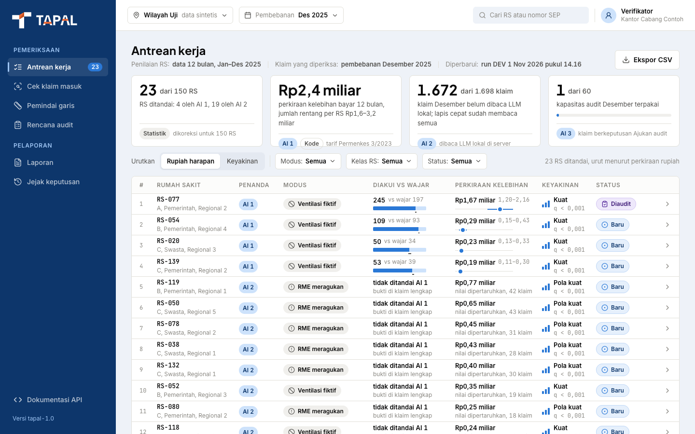
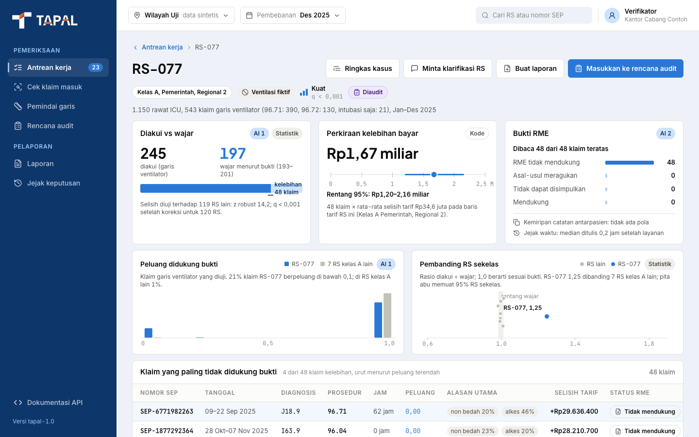
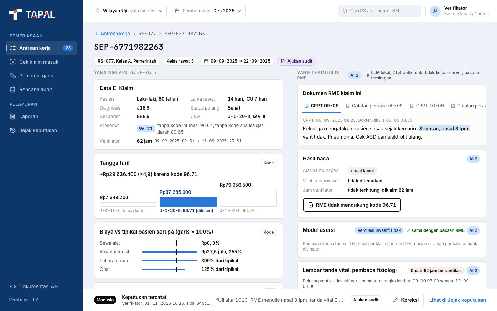
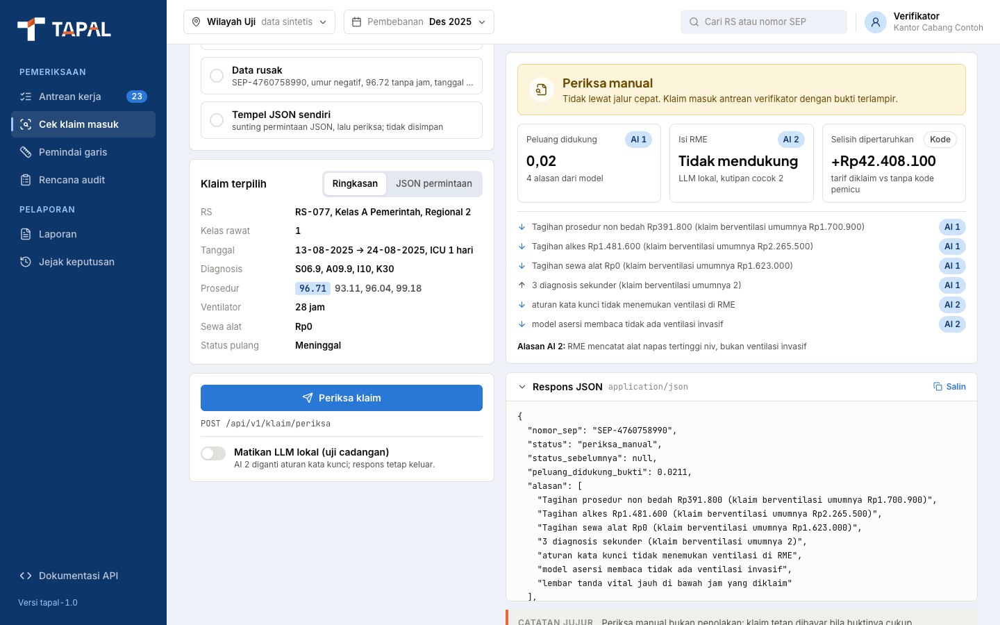
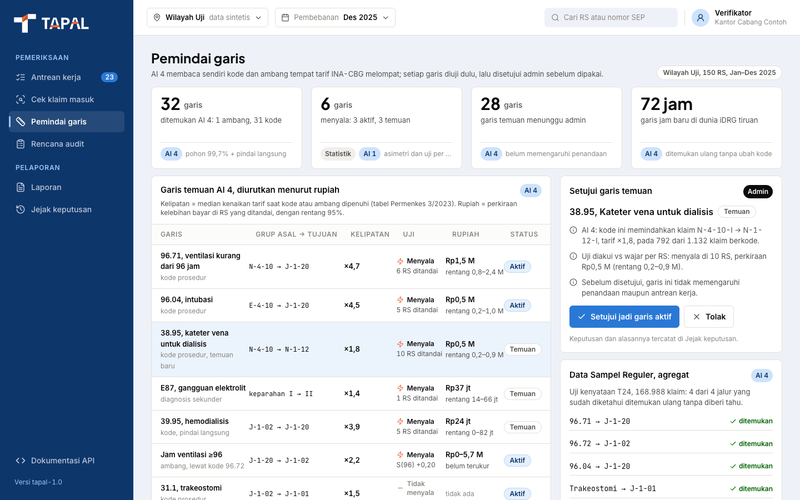
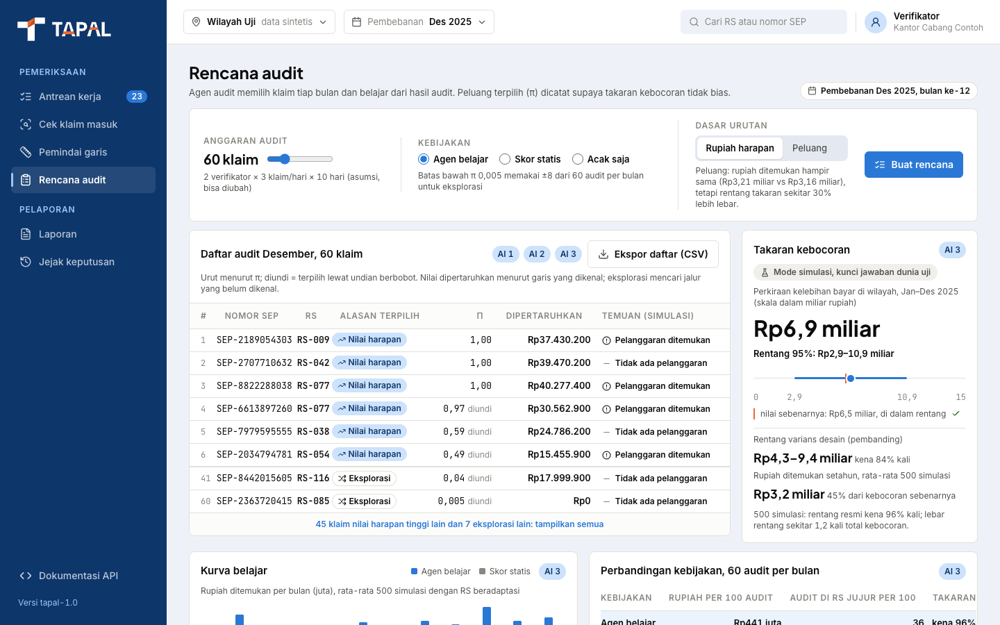
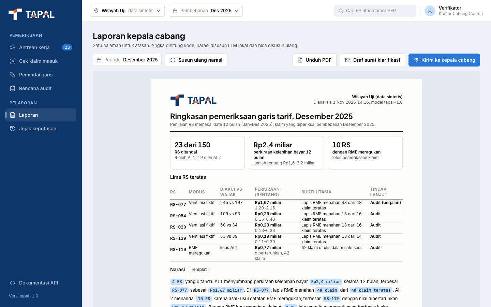
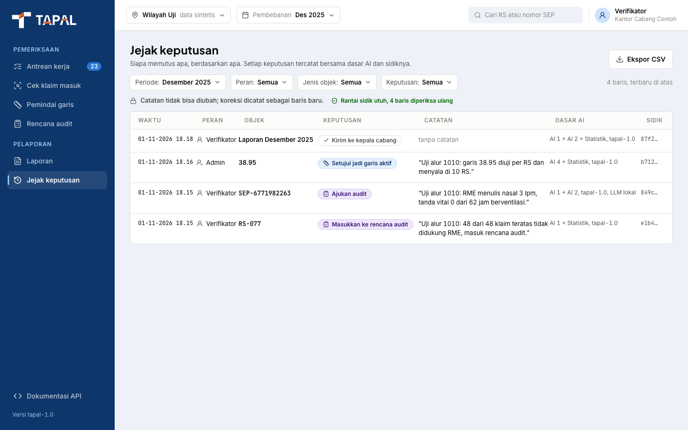
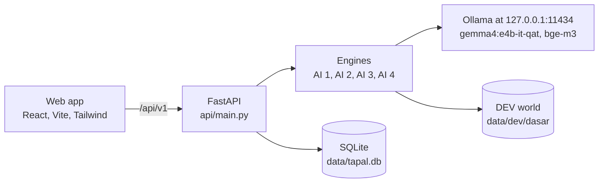

<p align="center">
  <picture>
    <source media="(prefers-color-scheme: dark)" srcset="docs/assets/tapal-logo-white.svg">
    
  </picture>
</p>

<h3 align="center">Tariff Anomaly Probe Across Lines</h3>

<p align="center"><i>"Kodenya sah. Buktinya ada?"</i> (The code is valid. Is the evidence there?)</p>

<p align="center"><b>English</b> | <a href="README.id.md">Bahasa Indonesia</a></p>

<p align="center">
  
  
  
  
  
  
  
</p>

## Contents

- [About](#about)
- [Screenshots](#screenshots)
- [How it works](#how-it-works)
- [Requirements](#requirements)
- [Installation](#installation)
- [Preparing the data](#preparing-the-data)
- [Running the app](#running-the-app)
- [Running the DEV pipeline](#running-the-dev-pipeline)
- [Running the tests](#running-the-tests)
- [Blind test rules](#blind-test-rules)
- [API](#api)
- [Project structure](#project-structure)
- [Troubleshooting](#troubleshooting)
- [Data, privacy, and attribution](#data-privacy-and-attribution)
- [Contributing](#contributing)
- [License](#license)

## About

TAPAL is a prototype for the BPJS Kesehatan Healthkathon 2026, Faskes category. It checks non-newborn inpatient claims that sit on the ventilator tariff line of INA-CBG: procedure codes 96.71 and 96.72, intubation 96.04, and the 96-hour line. It flags claims whose ventilator code or hours are not backed by the rest of the claim or by the electronic medical record (RME), and turns them into a verifier worklist, an overpayment estimate per hospital, and a monthly audit sample. AI estimates, statistics tests, and a human verifier makes every decision; all data in this repository is synthetic.

| Engine | What it does | Method |
|---|---|---|
| AI 1 | Estimates the chance that a claim is really ventilated (and reaches 96 hours) from the other evidence on the claim, then compares each hospital's recorded count with the count the evidence supports | Calibrated HistGradientBoosting, cross-fitted with folds grouped by hospital |
| AI 2 | Reads the RME. The LLM only copies quotes; code verifies every quote word for word and computes the ventilation hours. A clinical assertion model, a physiology reader, note similarity, and a write-time trail add independent checks | `gemma4:e4b-it-qat` through Ollama (temperature 0, seed 42, JSON schema output), `bge-m3` embeddings |
| AI 3 | Learning audit agent: chooses the claims to audit each month (exploit and explore), records each selection probability, and keeps the leakage estimate unbiased | Outcome model weighted by the inverse selection probability, with every π ≥ `PI_MIN` |
| AI 4 | Tariff line finder: discovers the trigger codes and thresholds where tariffs jump, then tests every line before it goes live | Surrogate model of the tariff function |
| Statistics | Tests each hospital against the others and checks the 96-hour line for bunching | Observed vs expected, Benjamini-Hochberg FDR, asymmetry test with placebo lines |

## Screenshots

<table>
  <tr>
    <td width="50%"><br><b>Antrean kerja</b>: flagged hospitals, ranked by estimated overpayment or by confidence</td>
    <td width="50%"><br><b>Profil RS</b>: recorded against supported claims, peer hospitals, top claims, and the RME evidence</td>
  </tr>
  <tr>
    <td><br><b>Pemeriksaan klaim</b>: tariff steps, AI 1 reasons, verified RME quotes, and the verifier decision</td>
    <td><br><b>Cek klaim masuk</b>: real-time check of one claim, with the LLM switch and a JSON editor</td>
  </tr>
  <tr>
    <td><br><b>Pemindai garis</b>: tariff lines found by AI 4 and the tests behind them</td>
    <td><br><b>Rencana audit</b>: the monthly audit list from AI 3 and the leakage estimate</td>
  </tr>
  <tr>
    <td><br><b>Laporan</b>: one-page report for the branch head, PDF export, and a draft clarification letter</td>
    <td><br><b>Jejak keputusan</b>: append-only decision log with a hash chain and CSV export</td>
  </tr>
</table>

The app interface is in Indonesian. All hospitals and claims on screen are synthetic.

## How it works



- **Two-stage response.** `POST /api/v1/klaim/periksa` returns the AI 1 result and the AI 2 quick layers at once. A single worker inside the API process then reads the RME with the local LLM, and the final status follows through `GET /api/v1/klaim/{nomor_sep}/rme`.
- **Fallback.** When the LLM is switched off or does not answer within 120 seconds, keyword rules read the record and the response still comes back.
- **Claim statuses.** `lolos_cepat` (fast track), `periksa_manual` (manual review), and `didukung_rme` (weak claim evidence, but the RME supports it).
- **Decision log.** Every verifier decision is appended to a SQLite table that rejects UPDATE and DELETE through triggers. Rows carry a chained SHA-256 fingerprint, which the API verifies at startup.
- **One address.** FastAPI serves the built web app from `web/dist`, so the app and the API share one port.

## Requirements

| Item | Version | Notes |
|---|---|---|
| Operating system | macOS or Linux | Reference machine: Apple M1 with 16 GB RAM. The one-command DEV pipeline needs macOS for now (see [Troubleshooting](#troubleshooting)). |
| Python | 3.12 | Tested on 3.12.2. The code uses the `sqlite3` autocommit mode, which needs Python 3.12. |
| Node.js | 24 | Tested on 24.21.0 with npm 11.19.0. Vite 8 needs Node 20.19+ or 22.12+. |
| Ollama | 0.40.13 | Local LLM server at `127.0.0.1:11434`. |
| Google Chrome | recent | Optional, only for the PDF report. |

Pull the two local models:

```bash
ollama pull gemma4:e4b-it-qat   # RME reader and narratives, about 6.2 GB
ollama pull bge-m3              # sentence embeddings for AI 2, about 1.2 GB
```

**Memory and disk.** 16 GB RAM is recommended, because the LLM, the embedding model, and the API run on one machine. Plan for about 10 GB of free disk for the models, the data, and `node_modules`. On a machine with less memory, run the app with `TAPAL_LLM=off`.

## Installation

Clone into a parent folder of its own, because the pipeline reports and the open ICU data live in folders next to the repository (`../tapal-percobaan` and `../tapal-data-terbuka`):

```bash
mkdir tapal && cd tapal
git clone https://github.com/iqbal-rahmatullah/tapal-ai.git tapal-v2
cd tapal-v2
```

Python packages, in a virtual environment:

```bash
python3.12 -m venv .venv
source .venv/bin/activate
python3 -m pip install -r requirements.txt
```

<details>
<summary>Python packages and what they are for</summary>

| Package | Version | Used for |
|---|---|---|
| fastapi | 0.139.2 | API (`api/`) |
| uvicorn | 0.51.0 | ASGI server |
| pydantic | 2.12.5 | API contracts and the LLM output schema |
| httpx | 0.28.1 | Ollama client and the FastAPI test client |
| numpy | 2.1.3 | numerics |
| pandas | 3.0.2 | claim tables |
| pyarrow | 24.0.0 | Parquet files |
| scipy | 1.17.1 | statistics, AI 4, world generator |
| scikit-learn | 1.8.0 | models of AI 1 to AI 4 |
| joblib | 1.5.3 | model files and the AI 1 DEV cache |
| matplotlib | 3.11.1 | DEV report charts |
| pytest | 8.4.2 | tests |

</details>

Web packages, locked in `web/package-lock.json`:

```bash
cd web
npm ci
cd ..
```

## Preparing the data

The repository holds code only. `data/` is ignored by git, so every machine builds its own inputs. Steps 1 to 4 are enough to start the app with AI 1 and the LLM reader. Step 5 adds the AI 2 quick layers and is required for the DEV pipeline.

| Input | Location | How to get it |
|---|---|---|
| Open ICU calibration | `data/calibration/icu_open.json`, `data/icu_open/*.parquet` | step 1 |
| Data Sampel calibration (aggregates only) | `data/calibration/data_sampel.json` | step 2 |
| DEV worlds | `data/dev/dasar/`, `data/dev/idrg_tiruan/` | step 3 |
| AI 1 model | `models/ai1-tapal-1.0.joblib` | step 4 |
| AI 2 models | `models/ai2-fisiologi-tapal-1.0.joblib`, `models/ai2-asersi-tapal-1.0.joblib` | trained by the API on first start (step 5) |
| DEV sentence embeddings | `../tapal-percobaan/ai2-dev/embedding_kalimat_*` | from the TAPAL team (step 5) |

### 1. Open ICU data (eICU-CRD Demo and MIMIC-IV Demo)

Both demos are open access on PhysioNet under the Open Database License (ODbL) v1.0. They are not part of this repository. Download them yourself into `../tapal-data-terbuka/`, keeping the folder names below, then summarise them:

```bash
mkdir -p ../tapal-data-terbuka/eicu-crd-demo-2.0.1 ../tapal-data-terbuka/mimic-iv-demo-2.2
curl -L -o ../tapal-data-terbuka/eicu-crd-demo-2.0.1/download.zip https://physionet.org/content/eicu-crd-demo/get-zip/2.0.1/
curl -L -o ../tapal-data-terbuka/mimic-iv-demo-2.2/download.zip https://physionet.org/content/mimic-iv-demo/get-zip/2.2/
unzip -q ../tapal-data-terbuka/eicu-crd-demo-2.0.1/download.zip -d ../tapal-data-terbuka/eicu-crd-demo-2.0.1
unzip -q ../tapal-data-terbuka/mimic-iv-demo-2.2/download.zip -d ../tapal-data-terbuka/mimic-iv-demo-2.2
python3 -m engine.synth.icu_open
```

The last command reads `eicu-crd-demo-2.0.1/eicu-collaborative-research-database-demo-2.0.1/` and `mimic-iv-demo-2.2/mimic-iv-clinical-database-demo-2.2/`, then writes `data/calibration/icu_open.json` and `data/icu_open/*.parquet`. Each extracted folder has a `SHA256SUMS.txt`; check it inside the folder with `shasum -a 256 -c SHA256SUMS.txt` on macOS or `sha256sum -c SHA256SUMS.txt` on Linux. Dataset pages: [eICU-CRD Demo 2.0.1](https://physionet.org/content/eicu-crd-demo/2.0.1/) and [MIMIC-IV Clinical Database Demo 2.2](https://physionet.org/content/mimic-iv-demo/2.2/).

### 2. Data Sampel calibration

The synthetic world is calibrated from aggregates of BPJS Data Sampel 2025, which this repository cannot share. If you have access, point the script at the folder that holds the `.dta` files:

```bash
python3 -m engine.synth.calibration --data "/path/to/Data Sampel Reguler Edisi 2025/data"
```

Without `--data`, it reads `~/Downloads/2025/Data Sampel Reguler Edisi 2025/data`. It writes only aggregate numbers to `data/calibration/data_sampel.json`. Keep the `.dta` files outside the repository: `.gitignore` excludes them, and a test fails if one appears inside. Without access, ask the TAPAL team for `data_sampel.json`.

### 3. DEV worlds

```bash
python3 -m engine.synth.build dev
python3 -m engine.synth.build dev --condition idrg_tiruan
python3 -m engine.synth.checks data/dev/dasar
```

- The first command builds the base world `data/dev/dasar/`: 150 synthetic hospitals, claims from January to December 2025, RME documents and vital sign sheets, and the open answer key in `data/dev/dasar/key/`.
- The second builds the iDRG mock world (claims only) that AI 4 uses in the DEV pipeline.
- The third is an optional sanity check that writes `checks.json` and `reality_table.csv` into the world folder.
- The seed is fixed (`SEED_DEV` = 20261031), so the same calibration files and the same package versions give the same world. A rebuild replaces the whole folder of that condition.

### 4. AI 1 model

```bash
python3 -m engine.ai1_dev
```

This trains AI 1 on the DEV world, writes `models/ai1-tapal-1.0.joblib` with its SHA-256 fingerprint in `models/ai1-tapal-1.0.json`, and writes the DEV report to `../tapal-percobaan/ai1-dev/`. The API refuses a model file that does not match its fingerprint.

### 5. AI 2 artifacts

The API loads AI 2 in a background thread when it starts. If `models/ai2-fisiologi-tapal-1.0.joblib` is missing, it trains the physiology reader from `data/icu_open/`. If `models/ai2-asersi-tapal-1.0.joblib` is missing, it trains the five hospital-fold assertion readers on the DEV world. Both are saved to `models/` for the next start.

The assertion readers need these DEV sentence embedding caches in `../tapal-percobaan/ai2-dev/`:

```text
embedding_kalimat_bge_m3.npy
embedding_kalimat_teks.parquet
embedding_kalimat_lain_bge_m3.npy
embedding_kalimat_lain_teks.parquet
```

The API reads these caches before it loads or trains either AI 2 model. No command in this repository builds the four files (about 270 MB together), so get them from the TAPAL team. Without them the app still runs: AI 1 answers and the LLM still reads the RME, but responses report that the AI 2 quick layers failed to load (`lapis AI 2 gagal dimuat`).

## Running the app

From the repository root:

```bash
cd web && npm run build && cd ..
python3 -m uvicorn api.main:app
```

Then open:

- App: <http://127.0.0.1:8000>
- API docs (Swagger UI): <http://127.0.0.1:8000/docs>

Notes:

- `npm run build` runs the TypeScript check and writes `web/dist`. The API serves `web/dist` only if it exists when the API starts, so build first.
- Run uvicorn as a single process, without `--workers`: the RME reading queue lives in that process.
- On first start AI 2 loads in the background, and trains its models if they are missing, so the first claim check can report that the quick layers are still loading.
- Before a demo, load the LLM into memory so the first reading does not wait for it:

  ```bash
  curl http://127.0.0.1:11434/api/generate -d '{"model": "gemma4:e4b-it-qat", "keep_alive": "2h"}'
  ```

### LLM switch

- Start without the LLM: `TAPAL_LLM=off python3 -m uvicorn api.main:app`. Keyword rules read the RME, and summaries are filled from templates.
- While the app runs, the switch on the Cek klaim masuk screen (`PUT /api/v1/llm` with `{"aktif": false}`) simulates an LLM outage for every screen until the API restarts. It never stops Ollama. `GET /api/v1/llm` shows `aktif`, `sakelar`, `tersedia`, and `model`.

### Development mode

```bash
python3 -m uvicorn api.main:app   # terminal 1, API on port 8000
cd web && npm run dev             # terminal 2, app on http://localhost:5173
```

Vite forwards `/api`, `/docs`, and `/openapi.json` to `127.0.0.1:8000`.

### Environment variables (API)

| Variable | Default | Effect |
|---|---|---|
| `TAPAL_LLM` | `on` | `off` turns the local LLM off; keyword rules and templates answer |
| `TAPAL_DB` | `data/tapal.db` | SQLite file for the decision log and the RME queue |
| `TAPAL_CHROME` | `/Applications/Google Chrome.app/Contents/MacOS/Google Chrome` | Chrome binary used by `GET /api/v1/laporan.pdf` |
| `TAPAL_WEB_URL` | address of the request | base URL that Chrome opens to print the report |

The Ollama address is fixed at `http://127.0.0.1:11434` in `engine/ai2.py`.

## Running the DEV pipeline

One command runs every engine on the DEV world:

```bash
python3 -m engine.run_all
```

- The stages are listed in `STAGES` in `engine/run_all.py`: AI 1, the line tests, AI 4, the AI 2 layers and LLM reading, and the AI 3 simulations. Up to four CPU stages run in parallel; the embedding and LLM stages run one at a time, so they never share the GPU. CPU slots shrink when free memory drops.
- A stage that ends with exit code 0 leaves a checkpoint at `../tapal-percobaan/run-all/<stage>.json` and is skipped on the next run; delete its `.json` to run it again. Logs are `<stage>.log` and `kejadian.log` in the same folder.
- To run only some stages, name them, for example `python3 -m engine.run_all ai1 garis ai4`. A stage whose dependency is neither named nor already done is held.
- The command prints a JSON summary (`selesai`, `gagal`, `tertahan`) and exits with code 1 if a stage failed.
- Reports go to `../tapal-percobaan/<name>/`, for example `ai1-dev`, `ai2-dev`, `ai3-dev`, `ai4-dev`, and `garis-dev`.
- It needs steps 1 to 5 above, Ollama running with both models, and macOS.
- The LLM reading stage (`ai2_baca`) accepts only the frozen model build: `ollama list` must show ID `ee6656371218` for `gemma4:e4b-it-qat`. A cold run reads a stratified sample at roughly 48 seconds per record on an M1, so it takes hours; a stopped run resumes from the readings already on disk.
- An extra evaluation stage, `hkeval`, runs only if `../tapal-percobaan/hkeval/jalankan.py` exists.

### Environment variables (engines)

| Variable | Default | Effect |
|---|---|---|
| `TAPAL_DUNIA` | `data/dev/dasar` | world folder to evaluate |
| `TAPAL_KUNCI` | `$TAPAL_DUNIA/key` | answer key folder |
| `TAPAL_KELUARAN` | `../tapal-percobaan` | output root; when set, a DEV run writes its models beside the results instead of into `models/` |
| `TAPAL_BUKA_SEGEL` | not set | blind test gate, see [Blind test rules](#blind-test-rules) |
| `TAPAL_LLM` | `on` | `off` turns the LLM off |
| `TAPAL_LLM_PARALEL` | `1` | parallel LLM requests in the reading stage |
| `OMP_NUM_THREADS` | `2` | threads per CPU stage, set by `run_all` when unset |

A DEV dry run that leaves `models/` untouched:

```bash
TAPAL_KELUARAN=../tapal-percobaan/run-dev python3 -m engine.run_all
```

## Running the tests

```bash
cd web && npm run build && cd ..
python3 -m pytest -q
```

- `tests/test_smoke.py` checks that FastAPI serves `web/dist`, so build the web app first.
- Tests that need the calibration files or the DEV world are skipped when those files are missing. The API tests also need the AI 1 model from step 4.
- The API tests use a temporary SQLite file and switch the LLM off, so the keyword fallback answers.
- `tests/test_blind_rules.py` guards the blind test: AI 2 holds no vocabulary of the held-out writing style, only the generator and `engine/data.py` name the blind folders, and AI 4 holds none of the known ventilator line values.

## Blind test rules

- Rules, targets, and frozen constants are in `TARGETS.md`. The hashes of `TARGETS.md`, of the TEST key manifest, and of the engine freeze (`freeze_manifest.json`) are recorded in `TARGETS.lock`, which is append only, with one commit per line. Hashes are never written inside `TARGETS.md`.
- DEV (`data/dev/`) uses a fixed seed, and its key may be opened. TEST is generated once with a random seed and used once: its public files are in `data/test/`, and its key is sealed in `data/sealed/`. Neither folder is in the repository.
- `engine/data.py` is the only gate. Any path inside `data/test` or `data/sealed` raises `BlindTestError` unless `TAPAL_BUKA_SEGEL=720` is set. It is set only at task 720, after the engine freeze hash is in `TARGETS.lock`, the hashes match, and the project owner gives the go-ahead.
- Once the seal is open, code, configuration, and thresholds do not change. Only fixes for crashes that stop a run are allowed, and each is recorded in full.
- `python3 -m engine.synth.build test` refuses to overwrite a sealed TEST set. `--replace-test` exists only for the time before the key hash is recorded.
- One RME writing style is held out and appears only in TEST. AI 2 must not contain vocabulary or rules specific to it.

## API

All endpoints are under `/api/v1`. JSON field names are Indonesian by design, for example `nomor_sep`, `peluang_didukung_bukti`, and `selisih_tarif_dipertaruhkan`. POST bodies must be sent with `Content-Type: application/json`. The interactive docs at `/docs` include a ready example claim.

| Method | Path | Screen | Purpose |
|---|---|---|---|
| POST | `/klaim/periksa` | Cek klaim masuk | check one claim: AI 1 and the AI 2 quick layers at once, RME reading queued |
| GET | `/klaim/{nomor_sep}/rme` | Cek klaim masuk, Pemeriksaan klaim | RME reading status and result |
| GET | `/klaim/contoh` | Cek klaim masuk | example claims from the DEV world |
| GET | `/klaim/{nomor_sep}` | Pemeriksaan klaim | claim detail and the last decision |
| GET | `/antrean` | Antrean kerja | flagged hospitals and summary |
| GET | `/rs/{kode_rs}` | Profil RS | hospital profile |
| POST | `/rs/{kode_rs}/ringkasan` | Profil RS | case summary written by the local LLM, with a template fallback |
| GET | `/pemindai` | Pemindai garis | tariff lines found by AI 4 |
| GET | `/audit/rencana` | Rencana audit | audit plan; query `anggaran`, `kebijakan`, `urutan` |
| GET | `/laporan` | Laporan | branch head report |
| GET, POST | `/laporan/narasi` | Laporan | report narrative |
| POST | `/laporan/surat/{kode_rs}` | Laporan | draft clarification letter |
| GET | `/laporan.pdf` | Laporan | report PDF printed by headless Chrome |
| GET, POST | `/keputusan` | Jejak keputusan, Pemeriksaan klaim | read or append the decision log |
| GET | `/keputusan.csv` | Jejak keputusan | decision log as CSV |
| GET, PUT | `/llm` | Cek klaim masuk | LLM status and switch |
| GET | `/health` | none | health check and model version |

Screen endpoints return a `sumber_data` field that tells whether the content comes from the engines or is still a design sample.

```bash
curl -s http://127.0.0.1:8000/api/v1/health
# {"status":"ok","versi_model":"tapal-1.0"}
```

## Project structure

```text
tapal-v2/
├── api/                  FastAPI app: main.py, routers/, samples.py, utils/
├── engine/               AI 1 to AI 4, statistics, DEV runners, run_all.py
│   └── synth/            synthetic world generator, grouper, tariff table, calibration
├── web/                  React, Vite, TypeScript, and Tailwind app with 8 screens
├── tests/                pytest suite
├── config/garis.json     tariff line configuration
├── models/               model files; joblib files are ignored by git, the AI 1 fingerprint is tracked
├── docs/                 logo and screenshots for this README
├── data/                 calibration, worlds, and SQLite; ignored by git
├── TARGETS.md            blind test targets and frozen constants
├── TARGETS.lock          append-only hash ledger
├── freeze_manifest.json  engine freeze manifest for the blind test
└── requirements.txt      pinned Python packages
```

Two folders next to the repository are also outside git: `../tapal-percobaan/` (pipeline reports and AI 2 DEV caches) and `../tapal-data-terbuka/` (open ICU data).

## Troubleshooting

| Symptom | Cause and fix |
|---|---|
| `FileNotFoundError: kalibrasi belum ada` | The calibration files are missing. Do steps 1 and 2. |
| The API stops at start with `FileNotFoundError` for `data/dev/dasar/claims.parquet` or `models/ai1-tapal-1.0.joblib` | Build the DEV world (step 3) and the AI 1 model (step 4). |
| `model file ai1-tapal-1.0.joblib does not match its recorded fingerprint` | The model file and `models/ai1-tapal-1.0.json` come from different runs. Run `python3 -m engine.ai1_dev` again; it rewrites both. |
| Responses say `lapis AI 2 gagal dimuat` | AI 2 could not load: the DEV embedding caches (step 5) are missing, or Ollama is not running with `bge-m3`. Fix it and restart the API. AI 1 keeps working meanwhile. |
| RME results always come from `aturan` (keyword rules) | The LLM is off. Check `TAPAL_LLM`, the switch on Cek klaim masuk (`GET /api/v1/llm`), and that Ollama answers at `127.0.0.1:11434` with `gemma4:e4b-it-qat`. |
| The app says "Tidak dapat terhubung ke server TAPAL" | The API is not running on port 8000. |
| `http://127.0.0.1:8000` returns `{"detail":"Not Found"}` | `web/dist` did not exist when the API started. Run `npm run build` in `web/`, then restart uvicorn. |
| A POST returns 422 | Send `Content-Type: application/json`. With that header, a 422 from `/klaim/periksa` lists the invalid fields in `galat`. |
| `GET /api/v1/laporan.pdf` returns 503 | Chrome was not found. Install Chrome or set `TAPAL_CHROME`, for example `/usr/bin/google-chrome` on Linux. |
| The example claims on Cek klaim masuk fail with error 500 | The examples are fixed SEP numbers from the team's DEV world. Rebuild the world from the same `data_sampel.json` with the pinned package versions. |
| `engine.run_all` fails on Linux with `FileNotFoundError` for `memory_pressure` | The pipeline reads free memory with the macOS tool `memory_pressure`. On Linux, run the stage modules from `STAGES` in `engine/run_all.py` one by one, for example `python3 -m engine.ai1_dev`. |
| `ai2_baca` stops with `versi LLM ... bukan versi beku` | The local `gemma4:e4b-it-qat` build differs from the frozen one (ID `ee6656371218`). |
| `BlindTestError` | `TAPAL_DUNIA` or `TAPAL_KUNCI` points into `data/test` or `data/sealed`. Those folders open only at task 720. |
| `npm ci` fails | Use Node 24 and run the command inside `web/`. |

## Data, privacy, and attribution

- TAPAL is a hackathon prototype, not an official BPJS Kesehatan application.
- There is no JKN participant data in this repository, in the app, or in its outputs. Training and test data are synthetic worlds calibrated from aggregates.
- BPJS Data Sampel files (`*.dta`) stay on the local machine, outside the repository, and only aggregate outputs may be processed with AI tools. `.gitignore` and `tests/test_smoke.py` enforce this.
- All hospitals are synthetic (`RS-001` to `RS-150`). TAPAL output is not a judgement on any real facility.
- The LLM runs only locally, through Ollama. No cloud model is used.
- Open ICU data: eICU-CRD Demo v2.0.1 and MIMIC-IV Clinical Database Demo v2.2, both under ODbL v1.0. They are de-identified records from hospitals in the United States, not JKN data, and they are not redistributed here. Please cite:
  - Pollard TJ, et al. eICU Collaborative Research Database Demo (version 2.0.1). PhysioNet.
  - Johnson A, et al. MIMIC-IV Clinical Database Demo (version 2.2). PhysioNet.
  - Goldberger AL, et al. PhysioBank, PhysioToolkit, and PhysioNet. Circulation 101(23), 2000.
- Tariffs follow Minister of Health Regulation (Permenkes) No. 3 of 2023 (`engine/synth/inacbg_tariff_permenkes_3_2023.tsv`).

## Contributing

- Names in code (folders, files, functions, variables) are in English. Text that users see in the app is in standard Indonesian. JSON field names stay in Indonesian, as in the design.
- The model version label is `tapal-1.0` everywhere (`engine.MODEL_VERSION`).
- Before a change goes to review, `python3 -m pytest -q` and `npm run build` pass, and screen changes are checked in a browser.
- Commit messages follow Conventional Commits.

## License

Licensed under the [Apache License 2.0](LICENSE); see also [NOTICE](NOTICE). The TAPAL name and logo are not covered. Open ICU data keeps its own ODbL license and is not included.
